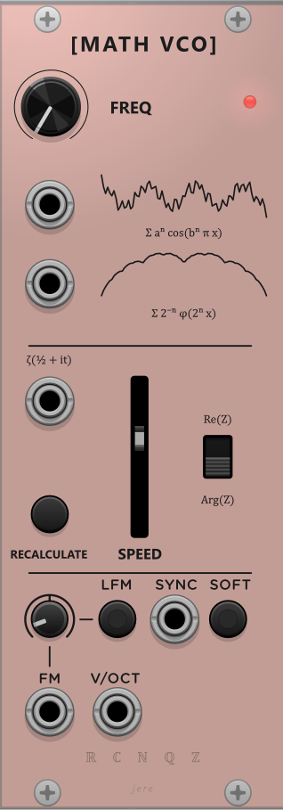

# Math VCO

VCV Rack 2 plugin

A VCO with the usual pitch tools (**V/Oct**, **FM / LFM**, **Sync / Soft**)  
The main feature here are the unique waveforms

## Waveforms

| **Waveform** | Notes |
| --- | --- |
| Weierstrass | Continuous but Nowhere Differentiable function|
| Takagi / Blancmange | funny pudding function |
| Riemann zeta | Walk along `ζ(½ + it)` |

Sample included: Weierstrass at **95.295 Hz** (sine wave-ish but sharper) 

## Riemann zeta

Heavy analytic continuation calculation required, so it is not a live oscillator.

1. Set **Speed** (how fast `t` moves) and mode **Arg(Z)** / **Re(Z)**
2. Hit **Recalculate**
3. Module stores and loops **~5 s** of audio at the current sample rate

It might take some time to do the calculation, please do not spam click the recalculate button!
Speed mapping is intentionally non-linear (more range at the top of the slider).

## Build

Standard VCV Rack plugin build (`make` against your Rack SDK).  

## Suggestions/Issues
Please put it up on issues page tyy!!

-----
Mathematical Analysis propaganda OwO  
Notes:  
For the Weierstrass function, the magic numbers are `a = 0.5`, `b = 7`, period scale `0.571` (geogebra-tested)
